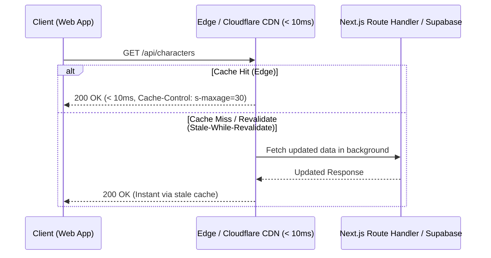

# ⚡ Edge Performance & Caching Runbook (< 10ms Target)

This skill operationalizes **Pillar 2: Ultra-Fast Speed (< 10ms)** from `AGENTS.md`. All public read operations must be cached at the edge or client layer to ensure near-instant responses.

---

## 🎯 The < 10ms Rule

Any API endpoint serving read data (character lists, tags, public profiles, rankings, shop packages) should respond in **under 10 milliseconds** when served via edge or CDN cache:



---

## 🛡️ Standard Caching Directives

### 1. Read-Heavy Public APIs (Characters, Packages, System Config)
Apply edge caching with stale-while-revalidate:
```typescript
import { NextResponse } from 'next/server';

export const dynamic = 'force-dynamic';

export async function GET() {
  const data = await fetchPublicCatalog();

  return NextResponse.json(data, {
    headers: {
      'Cache-Control': 'public, s-maxage=30, stale-while-revalidate=120',
      'CDN-Cache-Control': 'public, s-maxage=60',
    },
  });
}
```

### 2. Private / Authenticated APIs (User Coins, Session Data)
Private endpoints must **never** be cached publicly on the edge:
```typescript
return NextResponse.json(userPrivateData, {
  headers: {
    'Cache-Control': 'private, no-cache, no-store, must-revalidate',
  },
});
```

---

## 🏎️ Performance Anti-Patterns & Checklist

| Check Item | Anti-Pattern to Avoid | Standard Pattern |
| :--- | :--- | :--- |
| **Heavy Processing** | Synchronous complex loops inside GET handlers | Offload processing to database RPC or cache results |
| **Over-fetching** | `SELECT *` on wide tables with rich text | Select only the exact columns needed by the view |
| **Sequential Awaits** | `await a(); await b(); await c();` | `await Promise.all([a(), b(), c()])` |
| **Client Caching** | Polling without caching on client | Use SWR or React Query with deduplication interval |

---

## 🔄 Cache Invalidation & Mutation Protocol (Preventing Stale Data)

Whenever data is created, updated, or deleted via a mutation (POST, PUT, PATCH, DELETE), **caches must be purged immediately**:

### 1. Server-Side Invalidation (Next.js App Router)
Tag public read endpoints with cache tags, and invalidate them during mutations:
```typescript
import { revalidateTag, revalidatePath } from 'next/cache';
import { NextResponse } from 'next/server';

export async function POST(req: Request) {
  // 1. Perform database mutation through Anon Key + RLS
  await updateRecord(data);

  // 2. Explicitly invalidate cache tags to prevent stale data
  revalidateTag('characters');
  revalidatePath('/character/[slug]', 'page');

  return NextResponse.json({ success: true });
}
```

### 2. Client-Side Invalidation (SWR / React Query)
Trigger client revalidation immediately after mutation calls:
```typescript
import { mutate } from 'swr';

async function handleUpdate(newData) {
  await apiFetch('/api/characters', { method: 'POST', body: JSON.stringify(newData) });
  
  // Invalidate SWR cache key to fetch fresh data instantly
  await mutate('/api/characters');
}
```

---

## 🔍 Verification Checklist

When auditing a Route Handler:
1. Is it a RESTful GET/POST handler inside `src/app/api/...`?
2. Does it have appropriate `Cache-Control` headers for public data?
3. If it is a mutation (POST/PUT/DELETE), does it explicitly call `revalidateTag()` / `revalidatePath()`?
4. Are database queries bounded with pagination (`limit` / `offset` / cursors)?
5. Is it free from blocking CPU-intensive tasks?
